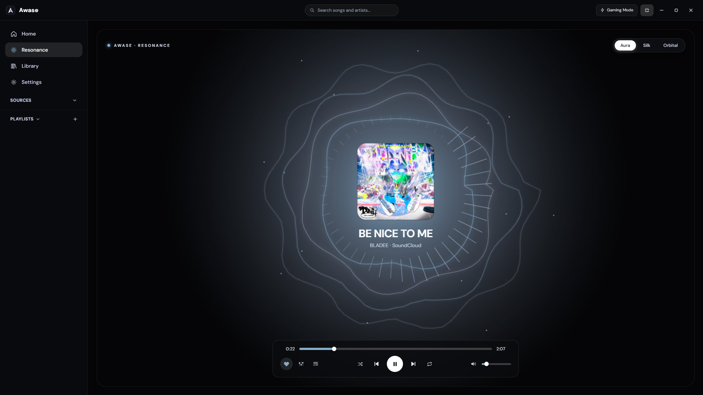
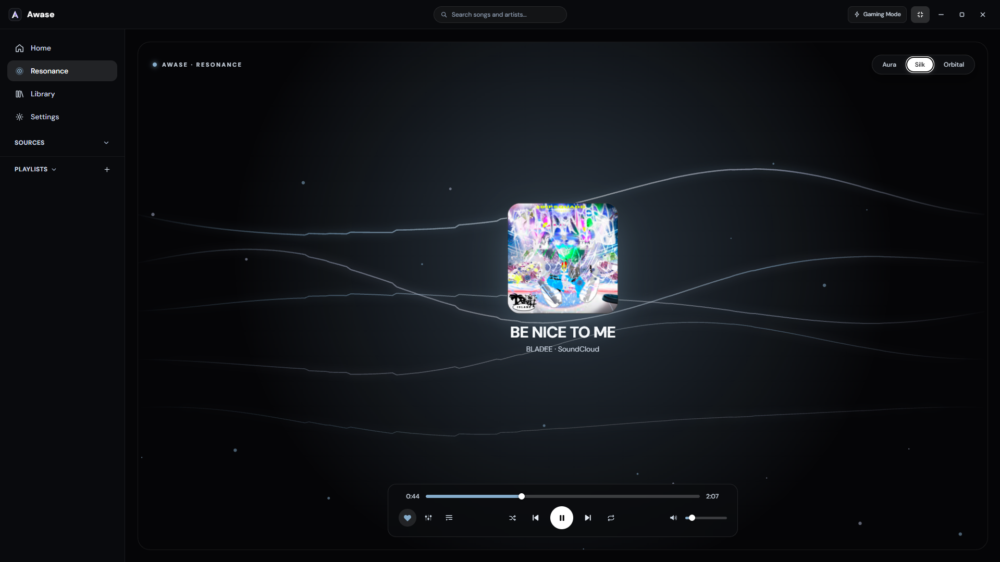
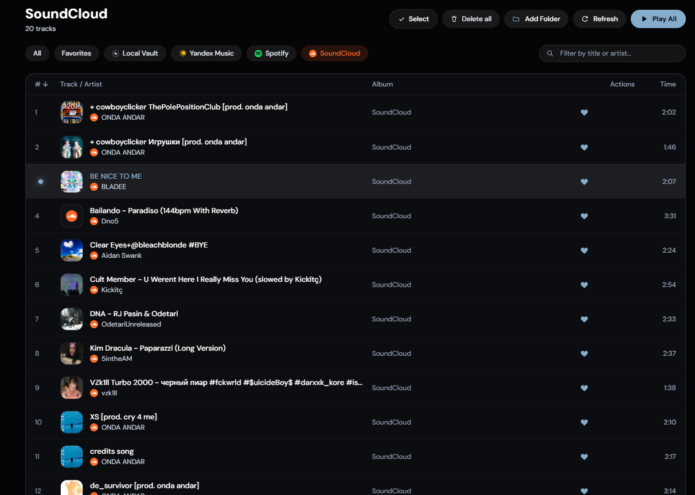
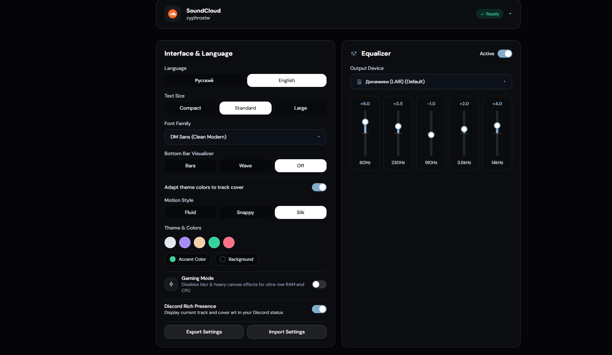
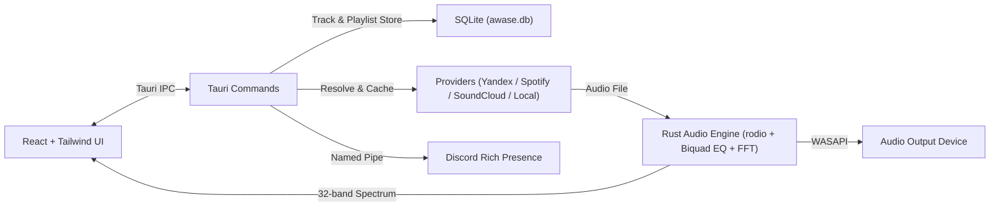

<div align="center">


# Awase

**Fast, low-RAM Windows desktop music player in Rust — unifying Local Lossless, Yandex Music, Spotify & SoundCloud.**

**English** | [Русский](README.ru.md)


</div>

---

## Preview

<p align="center">
  
  &nbsp;&nbsp;
  
</p>
<p align="center">
  
  &nbsp;&nbsp;
  
</p>

---

## Features

- **Unified Library** — Combine local lossless folders (`FLAC`, `WAV`, `MP3`, `M4A`, `AAC`, `OGG` with embedded cover art) alongside **Yandex Music**, **Spotify**, and **SoundCloud** in a single high-FPS virtualized library.
- **Native Rust Audio Engine & 5-Band EQ** — Powered by `rodio` + `symphonia` + `rustfft` with real-time 32-band FFT spectrum telemetry, musical 5-band parametric equalizer (`60Hz` – `14kHz`) with automatic preamp headroom, and custom output device selection.
- **Resonance Visualizers** — Three cover-color-reactive Canvas visualizers (**Aura**, **Silk**, **Orbital**) with integrated playback controls and `F11` fullscreen mode.
- **Zero-Premium Spotify & Native SoundCloud HLS/fMP4** — Import public Spotify playlists by URL or `.csv`/`.json` library exports without Premium (with automatic full-track matching across your connected sources), plus native Rust MPEG-TS & fMP4-to-ADTS-AAC demuxing for SoundCloud streams.
- **Cover-Adaptive & Custom Themes** — Pure OLED obsidian interface that adapts accents to the current track's album art, or lets you pick custom accent/background colors, typography, and motion presets (`Fluid`, `Snappy`, `Silk`).
- **Discord Rich Presence** — Native Windows Named Pipe IPC (`Listening to ...`) with track title, artist, cover art, and live progress bar (toggleable in Settings).
- **Gaming Mode & System Tray** — One-click **Gaming Mode** disables blur/canvas rendering, throttles telemetry, and trims the OS working set for minimal background RAM/CPU. Closing the window minimizes smoothly to the Windows system tray.
- **Full Settings Backup** — Export and import your UI preferences, EQ curve, local folders, playlists, and connected tokens as a single `.json` file.

---

## Architecture

| Module | Responsibility | Stack | Files |
| :--- | :--- | :--- | :--- |
| **Audio Engine** | Real-time decoding, 5-band biquad EQ, FFT spectrum analysis, and WASAPI device routing. | Rust (`rodio`, `cpal`, `rustfft`) | `src-tauri/src/audio_engine.rs` |
| **Providers** | Native API clients, HLS/MPEG-TS/fMP4 demuxing, Spotify embed/CSV/JSON importer, and local tag scanner. | Rust (`reqwest`, `lofty`, `roxmltree`) | `src-tauri/src/providers/*`, `src-tauri/src/local_scanner.rs` |
| **Core & IPC** | SQLite persistence, Windows system tray, Discord Rich Presence IPC, and Tauri commands. | Rust (`rusqlite`, `tauri`) | `src-tauri/src/db.rs`, `src-tauri/src/discord_rpc.rs`, `src-tauri/src/commands.rs` |
| **Desktop UI** | Virtualized library, Resonance visualizers, Queue drawer, custom EQ faders, and Theme customizer. | React, TypeScript, Tailwind CSS | `src/App.tsx`, `src/components/*` |



---

## Installation (Windows)

1. Download the latest `Awase_*_x64-setup.exe` from [Releases](https://github.com/Mono-no-Awares/Awase/releases).
2. Run the installer (per-user install, no administrator privileges required).

---

## Build from Source

### Prerequisites

- **Rust** (stable toolchain)
- **Node.js** (v20+)
- **Windows 10/11** with WebView2 Runtime

### Commands

```bash
npm install
npm run tauri build
```

The standalone executable and NSIS installer will be generated in `src-tauri/target/release/`.

---

## Privacy & Security

- All credentials, tokens, playlists, and cached audio stay **100% locally** on your machine (`%APPDATA%\dev.mononoawares.awase\`).
- Awase does not include analytics, telemetry, or third-party tracking.

---

## License

MIT © [Mono no Aware](https://github.com/Mono-no-Awares)
