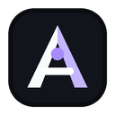
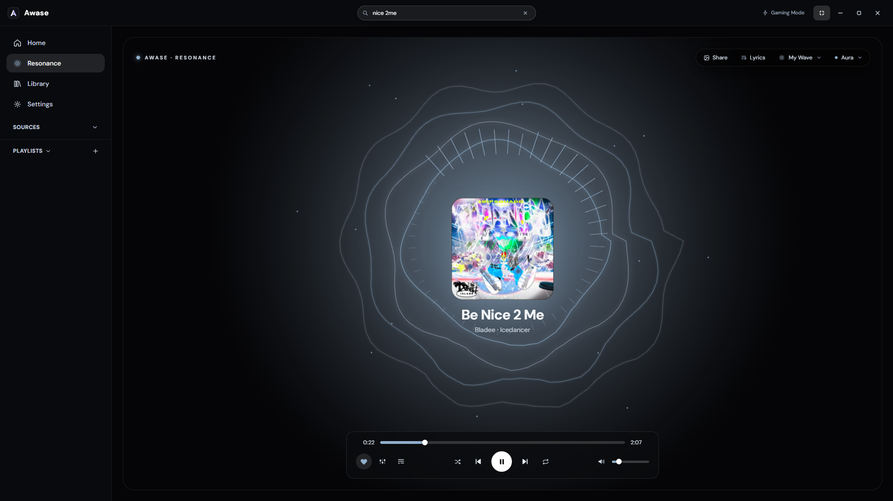
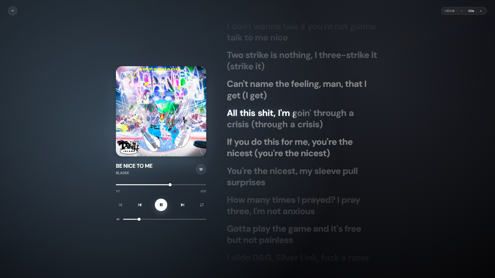
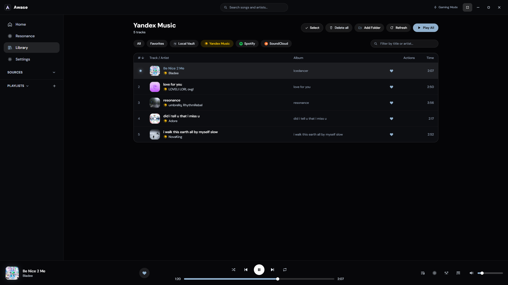
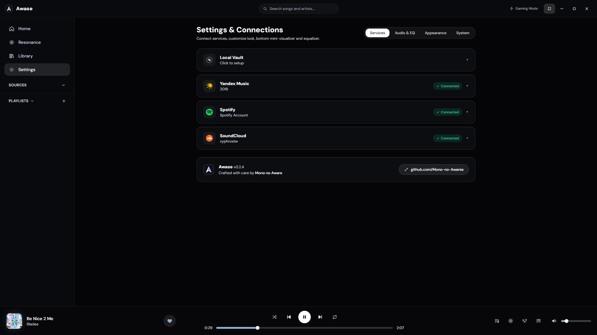

<div align="center">



# Awase

**Быстрый и лёгкий музыкальный плеер для Windows на Rust — объединяет локальные файлы, Яндекс Музыку, Spotify и SoundCloud.**

[English](README.md) | **Русский**


</div>

---

## Превью

| Резонанс — Аура | Полноэкранный Lyrics |
| :---: | :---: |
|  |  |
| **Коллекция** | **Настройки и Эквалайзер** |
|  |  |

---

## Возможности

- **Единая медиатека** — локальные папки (`FLAC`, `WAV`, `MP3`, `M4A`, `AAC`, `OGG` с обложками), **Яндекс Музыка**, **Spotify** и **SoundCloud** в быстром виртуализированном списке.
- **Нативный аудиодвижок на Rust + 5-полосный эквалайзер** — декодирование через `rodio` + `symphonia` + `rustfft`, 32-полосный FFT-спектр в реальном времени, музыкальный эквалайзер (`60Hz` – `14kHz`) с полками, 8 пресетами, автокомпенсацией перегрузок и выбором устройства вывода.
- **Визуализатор «Резонанс»** — три режима (**Аура**, **Шёлк**, **Орбита**), реагирующие на темп и цвета обложки, со встроенным управлением и полноэкранным режимом (`F11`).
- **Spotify Premium SDK и SoundCloud HLS/fMP4** — прямое воспроизведение Spotify Premium через официальный Web Playback SDK (полная синхронизация плейлистов >100 треков, лайков и импорт из ссылки/`.csv`/`.json`), а также встроенный демуксер MPEG-TS и fMP4 -> AAC со встроенным RU-обходом для SoundCloud.
- **Адаптивная и кастомная тема** — глубокий чёрный OLED-интерфейс с подстройкой акцентов под обложку трека, ручной настройкой цветов, шрифтов и стилей анимаций (`Fluid`, `Snappy`, `Silk`).
- **Discord Rich Presence** — нативная интеграция статуса *«Слушает...»* с обложкой и таймером трека (отключается в настройках).
- **Игровой режим и трей** — кнопка **Игровой режим** в шапке отключает canvas-рендеринг и анимации переходов, снижая нагрузку на RAM/CPU, а закрытие окна сворачивает плеер в системный трей.
- **Экспорт и импорт настроек** — резервное копирование настроек, эквалайзера, папок, плейлистов и токенов в один `.json` файл.

---

## Установка (Windows)

1. Скачайте `Awase_*_x64-setup.exe` со страницы [Releases](https://github.com/Mono-no-Awares/Awase/releases).
2. Запустите установщик (установка для текущего пользователя, права администратора не требуются).

---

## Сборка из исходников

```bash
npm install
npm run tauri build
```

Готовый `.exe` и NSIS-инсталлятор появятся в `src-tauri/target/release/`.

---

## Приватность и безопасность

- Все токены, плейлисты и кэш аудио хранятся **строго локально** на вашем ПК (`%APPDATA%\dev.mononoawares.awase\`).
- В приложении нет никакой телеметрии, аналитики или сторонних трекеров.

---

## Благодарности и тестирование

- **[StrongDeep01](https://github.com/StrongDeep01)** — тестирование и поиск багов (SoundCloud, Моя волна Яндекс Музыки, Lyrics, Discord RPC)

---

## Лицензия

**PolyForm Noncommercial License 1.0.0** © [Mono-no-Awares](https://github.com/Mono-no-Awares) — см. [LICENSE](LICENSE) и [NOTICE](NOTICE).

- **Разрешено:** личное, учебное и некоммерческое использование, изучение кода и некоммерческие форки с сохранением авторства и ссылки на [Mono-no-Awares/Awase](https://github.com/Mono-no-Awares/Awase).
- **Запрещено:** продажа, перепродажа, монетизация, коммерческое распространение и встраивание в коммерческие продукты или платные сервисы без письменного разрешения (`mononoawares.dev@gmail.com`). Название, логотип и иконки Awase защищены и не предназначены для выдачи сторонних сборок за официальные.
